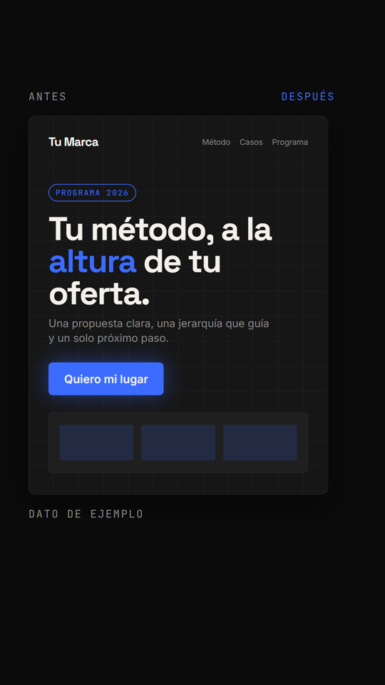

# before-after

Divisor que barre de una web vieja y genérica a una landing moderna hecha con los tokens de la marca. Etiquetas ANTES/DESPUÉS.

| | |
|---|---|
| Tipo | escenas |
| id de composición | `antesdespues` |
| Bloque(s) de la estructura | 5 Prueba · 4 Solución |
| Duración | 4 s por defecto |
| Cuándo usarla | La prueba más fuerte para landings. Con un caso real: reemplazar los mocks por capturas en `assets/media/`. |



## Parámetros

| Variable | Tipo | Qué es | Default |
|---|---|---|---|
| `etiqueta_antes` | string | Etiqueta antes | `ANTES` |
| `etiqueta_despues` | string | Etiqueta después | `DESPUÉS` |
| `marca_web` | string | Marca de la landing mock | `Tu Marca` |
| `badge` | string | Badge del hero | `PROGRAMA 2026` |
| `titular` | string | Titular de la landing | `Tu método, a la altura de tu oferta.` |
| `clave` | string | Palabras en acento (coma) | `altura` |
| `bajada` | string | Bajada | `Una propuesta clara, una jerarquía que guía y un solo próximo paso.` |
| `cta` | string | Botón | `Quiero mi lugar` |
| `rotulo` | string | Rótulo (vacío = sin rótulo) | `DATO DE EJEMPLO` |

Colores, fuentes, radios, sombras, easings y duraciones salen **siempre** de `tokens.css` de la marca del reel.

## Cómo montarla en un reel

```html
<div id="antesdespues" data-composition-id="antesdespues" data-composition-src="compositions/before-after.html"
  data-start="0" data-duration="4" data-track-index="2" data-track-kind="graphics"
  data-width="1080" data-height="1920" style="z-index: 2"
  data-variable-values='{"etiqueta_antes":"ANTES","etiqueta_despues":"DESPUÉS","marca_web":"Tu Marca"}'></div>
```

- `id`, `data-composition-id` y la clave del timeline son `antesdespues`: **no cambiarlos**. Para usar la misma pieza dos veces en un reel, duplicar el archivo y renombrar el id en las tres partes.
- `data-start` numérico (las escenas 3D lo usan para pasar el tiempo global a local).
- La salida se calcula sola con el `data-duration` del host.

## Probarla sola

```bash
bash scripts/laboratorio.sh before-after --marca personal --duracion 4
```
