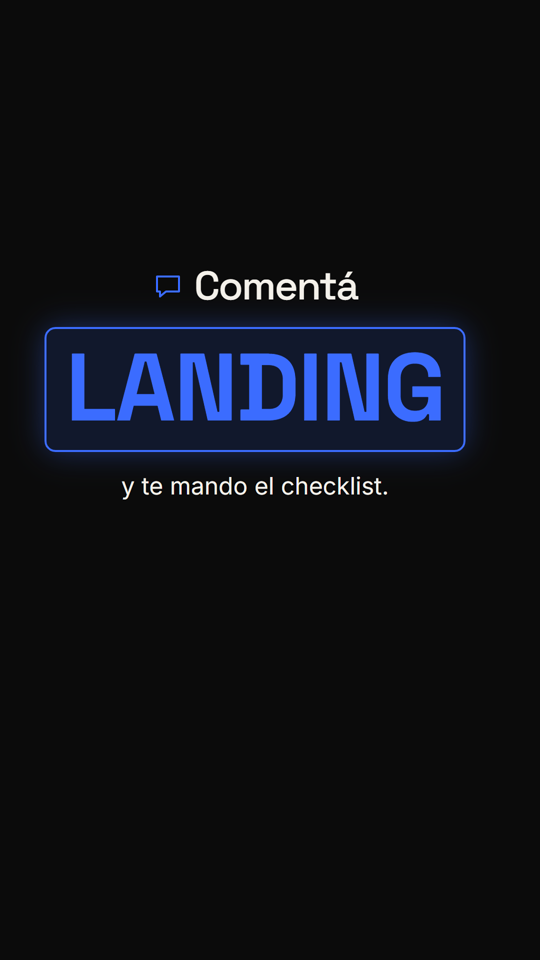

# cta-palabra-clave

"Comentá" + la palabra clave enorme (ajustada a ~760 px), letra por letra, dentro de un marco que se dibuja y un brillo que late una cantidad finita de veces. No tiene salida: es el final del reel.

| | |
|---|---|
| Tipo | escenas |
| id de composición | `cta` |
| Bloque(s) de la estructura | 7 Urgencia + CTA |
| Duración | 3 s por defecto |
| Cuándo usarla | Siempre en el cierre. |



## Parámetros

| Variable | Tipo | Qué es | Default |
|---|---|---|---|
| `filtro` | string | Filtro (opcional) | _(vacío)_ |
| `pre` | string | Texto antes | `Comentá` |
| `palabra` | string | Palabra clave | `LANDING` |
| `detalle` | string | Qué te mando | `y te mando el checklist.` |
| `pulsos` | number | Pulsos del brillo | `2` |

Colores, fuentes, radios, sombras, easings y duraciones salen **siempre** de `tokens.css` de la marca del reel.

## Cómo montarla en un reel

```html
<div id="cta" data-composition-id="cta" data-composition-src="compositions/cta-palabra-clave.html"
  data-start="0" data-duration="3" data-track-index="2" data-track-kind="graphics"
  data-width="1080" data-height="1920" style="z-index: 2"
  data-variable-values='{"filtro":"","pre":"Comentá","palabra":"LANDING"}'></div>
```

- `id`, `data-composition-id` y la clave del timeline son `cta`: **no cambiarlos**. Para usar la misma pieza dos veces en un reel, duplicar el archivo y renombrar el id en las tres partes.
- `data-start` numérico (las escenas 3D lo usan para pasar el tiempo global a local).
- La salida se calcula sola con el `data-duration` del host.

## Probarla sola

```bash
bash scripts/laboratorio.sh cta-palabra-clave --marca personal --duracion 3
```
