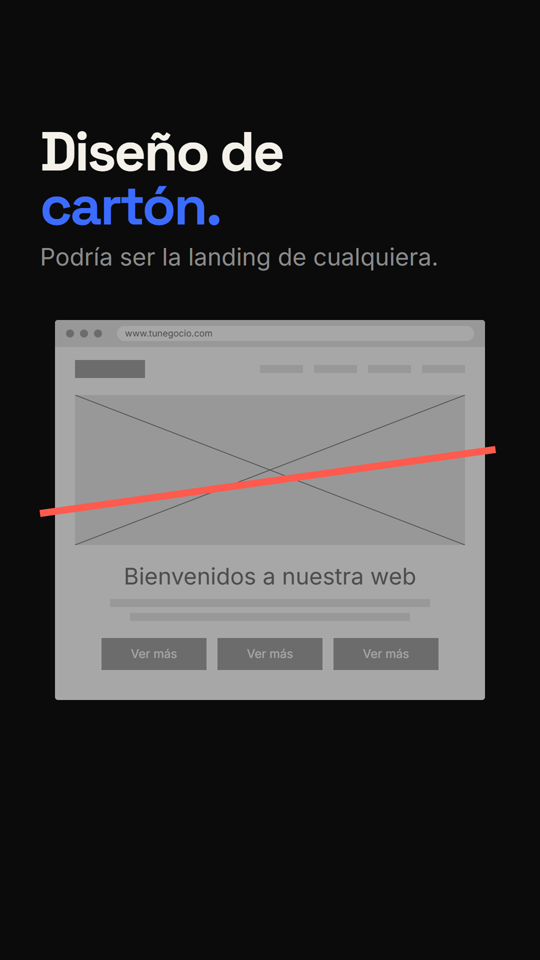

# enemigo-glitch

Web genérica gris (solo `--color-ugly-*`) que entra, se rompe con un glitch de franjas con semilla y queda apagada y tachada. Arriba, el nombre del enemigo.

| | |
|---|---|
| Tipo | escenas |
| id de composición | `enemigo` |
| Bloque(s) de la estructura | 3 Enemigo común |
| Duración | 3 s por defecto |
| Cuándo usarla | Para nombrar la práctica que el seguidor ideal hace hoy y no le funciona. |



## Parámetros

| Variable | Tipo | Qué es | Default |
|---|---|---|---|
| `titulo` | string | Nombre del enemigo | `Diseño de cartón.` |
| `sub` | string | Bajada | `Podría ser la landing de cualquiera.` |
| `clave` | string | Palabras en acento (coma) | `cartón.` |
| `url` | string | URL falsa | `www.tunegocio.com` |
| `titulo_web` | string | Titular de la web genérica | `Bienvenidos a nuestra web` |
| `boton_web` | string | Texto de los botones | `Ver más` |
| `semilla` | number | Semilla del glitch | `13` |
| `tachar` | boolean | Tachar la web | `true` |

Colores, fuentes, radios, sombras, easings y duraciones salen **siempre** de `tokens.css` de la marca del reel.

## Cómo montarla en un reel

```html
<div id="enemigo" data-composition-id="enemigo" data-composition-src="compositions/enemigo-glitch.html"
  data-start="0" data-duration="3" data-track-index="2" data-track-kind="graphics"
  data-width="1080" data-height="1920" style="z-index: 2"
  data-variable-values='{"titulo":"Diseño de cartón.","sub":"Podría ser la landing de cualquiera.","clave":"cartón."}'></div>
```

- `id`, `data-composition-id` y la clave del timeline son `enemigo`: **no cambiarlos**. Para usar la misma pieza dos veces en un reel, duplicar el archivo y renombrar el id en las tres partes.
- `data-start` numérico (las escenas 3D lo usan para pasar el tiempo global a local).
- La salida se calcula sola con el `data-duration` del host.

## Probarla sola

```bash
bash scripts/laboratorio.sh enemigo-glitch --marca personal --duracion 3
```
