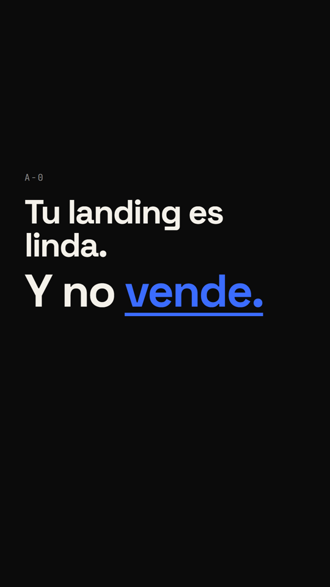

# gancho-tipografico

2–3 líneas grandes; cada palabra sube desde desenfoque a nítido con stagger. Las palabras clave van en el acento con subrayado que se dibuja. Con `portada=true` la línea 1 ya está en el fotograma 0 (miniatura legible).

| | |
|---|---|
| Tipo | escenas |
| id de composición | `gancho` |
| Bloque(s) de la estructura | 1 Gancho · 2 Promesa |
| Duración | 2.6 s por defecto |
| Cuándo usarla | Siempre en el gancho. También para la promesa (una sola línea). |



## Parámetros

| Variable | Tipo | Qué es | Default |
|---|---|---|---|
| `etiqueta` | string | Etiqueta (mono, arriba) | `A-0` |
| `linea1` | string | Línea 1 | `Tu landing es linda.` |
| `linea2` | string | Línea 2 | `Y no vende.` |
| `linea3` | string | Línea 3 (opcional) | _(vacío)_ |
| `clave` | string | Palabras en acento (coma) | `vende` |
| `portada` | boolean | Línea 1 visible en el fotograma 0 | `true` |
| `centrado` | boolean | Centrado | `false` |
| `arriba` | number | Posición vertical del bloque (px) | `560` |

Colores, fuentes, radios, sombras, easings y duraciones salen **siempre** de `tokens.css` de la marca del reel.

## Cómo montarla en un reel

```html
<div id="gancho" data-composition-id="gancho" data-composition-src="compositions/gancho-tipografico.html"
  data-start="0" data-duration="2.6" data-track-index="2" data-track-kind="graphics"
  data-width="1080" data-height="1920" style="z-index: 2"
  data-variable-values='{"etiqueta":"A-0","linea1":"Tu landing es linda.","linea2":"Y no vende."}'></div>
```

- `id`, `data-composition-id` y la clave del timeline son `gancho`: **no cambiarlos**. Para usar la misma pieza dos veces en un reel, duplicar el archivo y renombrar el id en las tres partes.
- `data-start` numérico (las escenas 3D lo usan para pasar el tiempo global a local).
- La salida se calcula sola con el `data-duration` del host.

## Probarla sola

```bash
bash scripts/laboratorio.sh gancho-tipografico --marca personal --duracion 2.6
```
