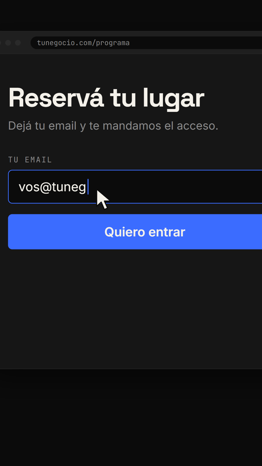

# mockup-ui-cursor

Ventana de app/landing con cursor falso: clic en un campo, tipeo, clic en el botón y mensaje de éxito. Zoom de cámara estilo Screen Studio.

| | |
|---|---|
| Tipo | escenas |
| id de composición | `mockup` |
| Bloque(s) de la estructura | 4 Solución · 5 Prueba (proceso en vivo) |
| Duración | 5 s por defecto |
| Cuándo usarla | Mostrar el producto funcionando, un flujo de la app o un clic→éxito. |



## Parámetros

| Variable | Tipo | Qué es | Default |
|---|---|---|---|
| `url` | string | URL | `tunegocio.com/programa` |
| `titulo` | string | Título de la pantalla | `Reservá tu lugar` |
| `bajada` | string | Bajada | `Dejá tu email y te mandamos el acceso.` |
| `etiqueta` | string | Etiqueta del campo | `Tu email` |
| `tipeo` | string | Texto que se escribe | `vos@tunegocio.com` |
| `boton` | string | Botón | `Quiero entrar` |
| `exito` | string | Mensaje de éxito | `Listo. Ya estás adentro.` |
| `zoom` | number | Zoom de cámara | `1.45` |

Colores, fuentes, radios, sombras, easings y duraciones salen **siempre** de `tokens.css` de la marca del reel.

## Cómo montarla en un reel

```html
<div id="mockup" data-composition-id="mockup" data-composition-src="compositions/mockup-ui-cursor.html"
  data-start="0" data-duration="5" data-track-index="2" data-track-kind="graphics"
  data-width="1080" data-height="1920" style="z-index: 2"
  data-variable-values='{"url":"tunegocio.com/programa","titulo":"Reservá tu lugar","bajada":"Dejá tu email y te mandamos el acceso."}'></div>
```

- `id`, `data-composition-id` y la clave del timeline son `mockup`: **no cambiarlos**. Para usar la misma pieza dos veces en un reel, duplicar el archivo y renombrar el id en las tres partes.
- `data-start` numérico (las escenas 3D lo usan para pasar el tiempo global a local).
- La salida se calcula sola con el `data-duration` del host.

## Probarla sola

```bash
bash scripts/laboratorio.sh mockup-ui-cursor --marca personal --duracion 5
```
