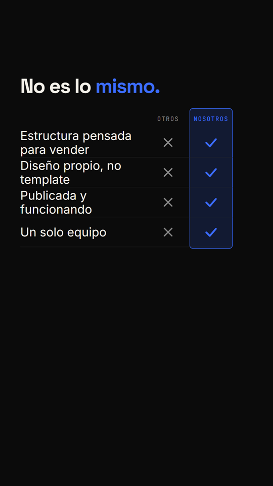

# nosotros-vs-otros

Tabla comparativa: ✕ gris para otros, check en el acento para nosotros; la columna nuestra se resalta con un marco; filas en secuencia.

| | |
|---|---|
| Tipo | escenas |
| id de composición | `comparativa` |
| Bloque(s) de la estructura | 6 Valor + objeción |
| Duración | 4 s por defecto |
| Cuándo usarla | Desarmar la objeción típica ("lo hago con IA", "otro cobra menos"). |



## Parámetros

| Variable | Tipo | Qué es | Default |
|---|---|---|---|
| `titulo` | string | Título | `No es lo mismo.` |
| `clave` | string | Palabras en acento (coma) | `mismo.` |
| `col_otros` | string | Columna otros | `Otros` |
| `col_nosotros` | string | Columna nosotros | `Nosotros` |
| `filas` | string | Filas (separadas por ;) | `Estructura pensada para vender;Diseño propio, no template;Publicada y funcionando;Un solo equipo` |

Colores, fuentes, radios, sombras, easings y duraciones salen **siempre** de `tokens.css` de la marca del reel.

## Cómo montarla en un reel

```html
<div id="comparativa" data-composition-id="comparativa" data-composition-src="compositions/nosotros-vs-otros.html"
  data-start="0" data-duration="4" data-track-index="2" data-track-kind="graphics"
  data-width="1080" data-height="1920" style="z-index: 2"
  data-variable-values='{"titulo":"No es lo mismo.","clave":"mismo.","col_otros":"Otros"}'></div>
```

- `id`, `data-composition-id` y la clave del timeline son `comparativa`: **no cambiarlos**. Para usar la misma pieza dos veces en un reel, duplicar el archivo y renombrar el id en las tres partes.
- `data-start` numérico (las escenas 3D lo usan para pasar el tiempo global a local).
- La salida se calcula sola con el `data-duration` del host.

## Probarla sola

```bash
bash scripts/laboratorio.sh nosotros-vs-otros --marca personal --duracion 4
```
