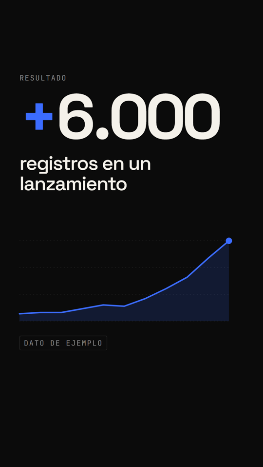

# prueba-contador

Cifra grande que cuenta (tabular, miles con punto) + gráfico de línea que se dibuja a la par, con punto y halo. Rótulo `DATO DE EJEMPLO`.

| | |
|---|---|
| Tipo | escenas |
| id de composición | `contador` |
| Bloque(s) de la estructura | 5 Prueba |
| Duración | 3 s por defecto |
| Cuándo usarla | Resultado con cifra. Solo datos reales con permiso o rotulados. |



## Parámetros

| Variable | Tipo | Qué es | Default |
|---|---|---|---|
| `etiqueta` | string | Etiqueta | `RESULTADO` |
| `valor` | number | Valor final | `6000` |
| `desde` | number | Valor inicial | `0` |
| `decimales` | number | Decimales | `0` |
| `prefijo` | string | Prefijo | `+` |
| `sufijo` | string | Sufijo | _(vacío)_ |
| `texto` | string | Texto bajo la cifra | `registros en un lanzamiento` |
| `clave` | string | Palabras en acento (coma) | _(vacío)_ |
| `serie` | string | Serie del gráfico (coma) | `2,3,3,6,9,8,14,22,31,46,60` |
| `rotulo` | string | Rótulo (vacío = sin rótulo) | `DATO DE EJEMPLO` |
| `conteo` | number | Duración del conteo (s) | `1.6` |

Colores, fuentes, radios, sombras, easings y duraciones salen **siempre** de `tokens.css` de la marca del reel.

## Cómo montarla en un reel

```html
<div id="contador" data-composition-id="contador" data-composition-src="compositions/prueba-contador.html"
  data-start="0" data-duration="3" data-track-index="2" data-track-kind="graphics"
  data-width="1080" data-height="1920" style="z-index: 2"
  data-variable-values='{"etiqueta":"RESULTADO","valor":6000,"desde":0}'></div>
```

- `id`, `data-composition-id` y la clave del timeline son `contador`: **no cambiarlos**. Para usar la misma pieza dos veces en un reel, duplicar el archivo y renombrar el id en las tres partes.
- `data-start` numérico (las escenas 3D lo usan para pasar el tiempo global a local).
- La salida se calcula sola con el `data-duration` del host.

## Probarla sola

```bash
bash scripts/laboratorio.sh prueba-contador --marca personal --duracion 3
```
