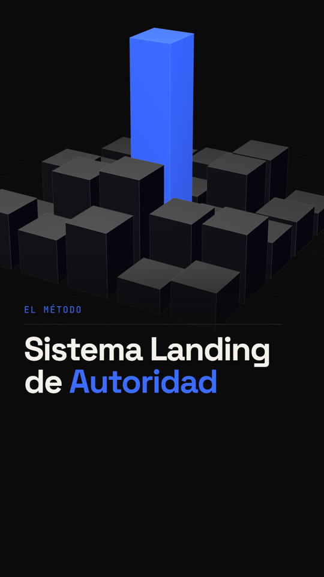

# solucion-reveal-3d

Estructura de módulos 3D (Three.js) que se levanta desde el piso; el núcleo brilla con el acento; dolly-out y órbita lenta. Debajo, el nombre del método.

| | |
|---|---|
| Tipo | escenas |
| id de composición | `reveal3d` |
| Bloque(s) de la estructura | 4 Solución con nombre propio |
| Duración | 4.5 s por defecto |
| Cuándo usarla | El momento de más producción: revelar el método o sistema con nombre. Alternativa: reemplazar el `<canvas>` por un `<video muted>` exportado de Spline/Unicorn a `assets/<marca>/3d/`. |



## Parámetros

| Variable | Tipo | Qué es | Default |
|---|---|---|---|
| `etiqueta` | string | Etiqueta | `EL MÉTODO` |
| `nombre` | string | Nombre del método | `Sistema Landing de Autoridad` |
| `clave` | string | Palabras en acento (coma) | `Autoridad` |
| `semilla` | number | Semilla | `7` |
| `modulos` | number | Módulos por lado | `5` |

Colores, fuentes, radios, sombras, easings y duraciones salen **siempre** de `tokens.css` de la marca del reel.

## Cómo montarla en un reel

```html
<div id="reveal3d" data-composition-id="reveal3d" data-composition-src="compositions/solucion-reveal-3d.html"
  data-start="0" data-duration="4.5" data-track-index="2" data-track-kind="graphics"
  data-width="1080" data-height="1920" style="z-index: 2"
  data-variable-values='{"etiqueta":"EL MÉTODO","nombre":"Sistema Landing de Autoridad","clave":"Autoridad"}'></div>
```

- `id`, `data-composition-id` y la clave del timeline son `reveal3d`: **no cambiarlos**. Para usar la misma pieza dos veces en un reel, duplicar el archivo y renombrar el id en las tres partes.
- `data-start` numérico (las escenas 3D lo usan para pasar el tiempo global a local).
- La salida se calcula sola con el `data-duration` del host.

## Probarla sola

```bash
bash scripts/laboratorio.sh solucion-reveal-3d --marca personal --duracion 4.5
```
