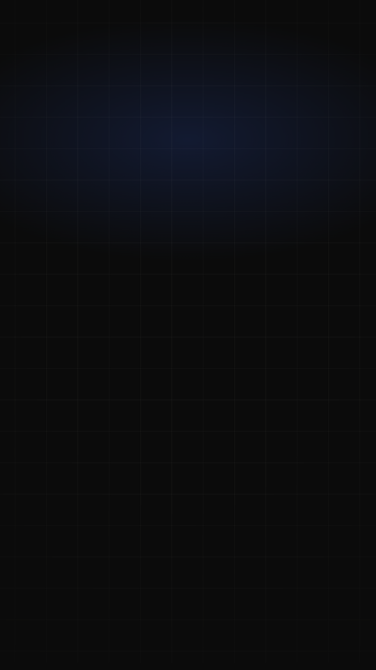

# grilla-brillo

Grilla técnica fina con un brillo del acento que recorre la pantalla de arriba abajo.

| | |
|---|---|
| Tipo | fondos |
| id de composición | `grilla` |
| Bloque(s) de la estructura | Fondo |
| Duración | la del slot (se adapta) |
| Cuándo usarla | Fondo por defecto de marcas técnicas (personal, SYNX, Synous). |



## Parámetros

| Variable | Tipo | Qué es | Default |
|---|---|---|---|
| `intensidad` | number | Intensidad del brillo | `0.35` |

Colores, fuentes, radios, sombras, easings y duraciones salen **siempre** de `tokens.css` de la marca del reel.

## Cómo montarla en un reel

```html
<div id="grilla" data-composition-id="grilla" data-composition-src="compositions/grilla-brillo.html"
  data-start="0" data-duration="15" data-track-index="2" data-track-kind="graphics"
  data-width="1080" data-height="1920" style="z-index: 2"
  data-variable-values='{"intensidad":0.35}'></div>
```

- `id`, `data-composition-id` y la clave del timeline son `grilla`: **no cambiarlos**. Para usar la misma pieza dos veces en un reel, duplicar el archivo y renombrar el id en las tres partes.
- `data-start` numérico (las escenas 3D lo usan para pasar el tiempo global a local).
- La salida se calcula sola con el `data-duration` del host.

## Probarla sola

```bash
bash scripts/laboratorio.sh grilla-brillo --marca personal --duracion 4
```
