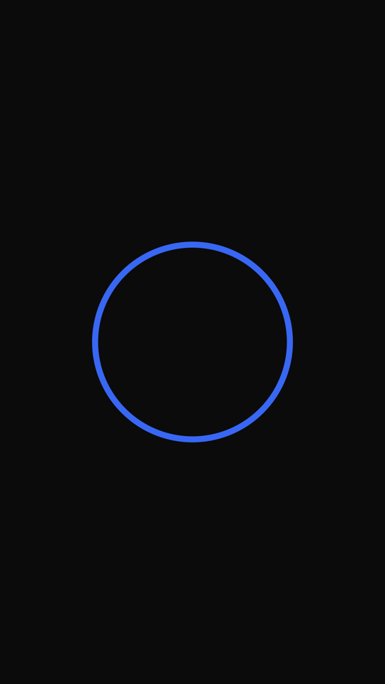

# zoom-through

Círculo del color de fondo que crece desde un punto con un anillo de acento adelante, y se disuelve.

| | |
|---|---|
| Tipo | transiciones |
| id de composición | `zoomthrough` |
| Bloque(s) de la estructura | Transición |
| Duración | 0.6 s por defecto |
| Cuándo usarla | Atravesar un botón o un elemento hacia la escena siguiente. Montar en `corte − 0.35` con `x`/`y` en el elemento. |



## Parámetros

| Variable | Tipo | Qué es | Default |
|---|---|---|---|
| `x` | number | Centro X (px) | `540` |
| `y` | number | Centro Y (px) | `960` |

Colores, fuentes, radios, sombras, easings y duraciones salen **siempre** de `tokens.css` de la marca del reel.

## Cómo montarla en un reel

```html
<div id="zoomthrough" data-composition-id="zoomthrough" data-composition-src="compositions/zoom-through.html"
  data-start="0" data-duration="0.6" data-track-index="2" data-track-kind="graphics"
  data-width="1080" data-height="1920" style="z-index: 2"
  data-variable-values='{"x":540,"y":960}'></div>
```

- `id`, `data-composition-id` y la clave del timeline son `zoomthrough`: **no cambiarlos**. Para usar la misma pieza dos veces en un reel, duplicar el archivo y renombrar el id en las tres partes.
- `data-start` numérico (las escenas 3D lo usan para pasar el tiempo global a local).
- La salida se calcula sola con el `data-duration` del host.

## Probarla sola

```bash
bash scripts/laboratorio.sh zoom-through --marca personal --duracion 0.6
```
